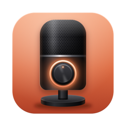
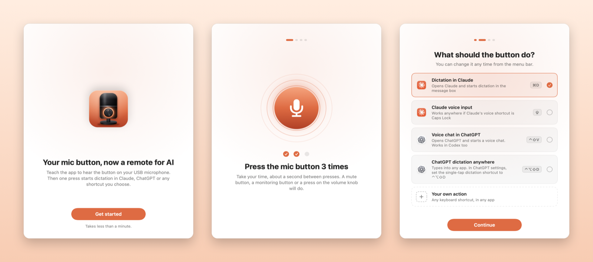

<p align="center">
  
</p>

<h1 align="center">Tapline</h1>

<p align="center"><b>The button on your USB microphone, now a remote for AI.</b><br>
A macOS menu bar app that turns the mute, monitor or knob button of an ordinary wired microphone into a trigger for dictation in Claude, voice chat in ChatGPT, or any keyboard shortcut.</p>

<p align="center"><a href="README.ru.md">Русская версия</a> · <a href="docs/microphones.md">Which microphones work</a></p>

Many USB microphones have a button: mute, headphone monitoring, or a press on the volume knob. Tapline turns that press into an action on your Mac. Press it, and dictation starts in Claude. Press again, and it stops. You don't need a macro pad or an extra remote.



## What it does

**Learns your button.** During setup you press the button three times. Tapline watches the microphone's switches and HID reports and keeps the signal that changed in step with your presses. There is no list of supported models: try your mic, and setup tells you if it can't hear the button.

**Gives it a job.** Built in:

| Action | What happens |
|---|---|
| Dictation in Claude | Opens Claude and starts dictation in the message box (⌘D) |
| Claude voice input anywhere | Starts Claude's voice input from any app. Set Claude's voice shortcut to Caps Lock first |
| Voice chat in ChatGPT | Opens ChatGPT and starts a voice chat (⌃⇧V). Works in Codex too |
| ChatGPT dictation anywhere | Types what you say into any app. In ChatGPT's dictation settings, set the single-tap shortcut to ⌃⌥⇧D first |
| Mute in Zoom, Teams, Slack, Discord | Brings the call app forward for a moment, toggles your mic in the call and takes you back to where you were |
| Your own action | Any keyboard shortcut, sent to a chosen app or to whatever is in front |

**Easy to switch back.** Choose "Does its usual job" in the menu bar and Tapline leaves the button alone.

## Does the button still do its old job?

It depends on the mic. When a press flips a switch the computer can write to, Tapline flips it back, so a mute button starts dictation without muting you. Some mics don't accept that write: on the RØDE NT-USB Mini the knob still toggles headphone monitoring. Buttons that report through HID always keep their old job. Setup tells you which case you have.

## How it works

Many USB microphones handle their button in firmware. Press it and the mic quietly flips a switch inside itself, say headphone monitoring, without telling the computer. That switch can still be read over USB, the same way macOS reads the mic's volume. Tapline checks it twenty times a second, notices the flip and runs your action.

Microphones that report the press as a HID event work as well. Tapline opens only the microphone's own vendor and telephony HID interfaces and skips anything that looks like a keyboard, mouse or media keys, so macOS doesn't ask for Input Monitoring.

What can't work: Bluetooth microphones, and buttons that act entirely inside the mic without changing anything the computer can read. The [microphone list](docs/microphones.md) has what we know about popular models.

## Install

You need macOS 14 or later and the Xcode Command Line Tools (`xcode-select --install`).

```bash
git clone https://github.com/vnptb/tapline.git
cd tapline
./build.sh
```

The script installs Tapline into `/Applications` and opens it. To press keyboard shortcuts, Tapline needs the Accessibility permission, and macOS asks for it once.

Builds are signed ad hoc, and macOS ties the permission to one exact build. After you rebuild, remove Tapline from System Settings → Privacy & Security → Accessibility with "−" and allow it again. To keep the permission across rebuilds, sign with a code-signing certificate (a self-signed one is fine): `SIGN_IDENTITY="Your Certificate" ./build.sh`.

To change the icon, edit `icon/icon.svg` and run `icon/make_icon.sh`.

## Microphones

| Microphone | Button | Works |
|---|---|---|
| RØDE NT-USB Mini | Press on the headphone knob (monitoring) | ✅ Tested |
| Shure MV7+, Shure MV6, HyperX SoloCast, Elgato Wave:3 | Tap-to-mute | 🟢 Should work |
| RØDE PodMic USB, XCM-50, XDM-100 | Press on the headphone knob (monitoring), same design as the NT-USB Mini | 🟡 Might work |
| HyperX QuadCast, DuoCast, Blue Yeti, Yeti X, Yeti Nano, Razer Seiren, Audio-Technica AT2020USB-X, Sennheiser Profile, AKG Lyra, Elgato Wave:1 and Wave Neo, FIFINE, MAONO, JBL Quantum Stream and more | Mute button, tap-to-mute or push-in knob | 🟡 Might work |
| HyperX QuadCast S, QuadCast 2, Logitech G Yeti GX, Shure MV7 | Tap-to-mute | 🟡 Might work, but the mic stays muted |

The [full list](docs/microphones.md) covers more than 90 models from RØDE, Shure, HyperX, Elgato, Blue, Razer, Audio-Technica, FIFINE, MAONO and others. Tried a mic? [Open an issue](https://github.com/vnptb/tapline/issues/new) with the model, the button you pressed and whether setup recognized it.

## Privacy

Tapline doesn't record or listen to audio: it opens no audio stream, so macOS never asks for microphone access. Over USB it reads the mic's switches (mute, monitoring) and its button reports. After a press it writes back the switch the button flipped, and that is the only thing it ever writes to the mic. Nothing leaves your Mac.

## License

MIT
