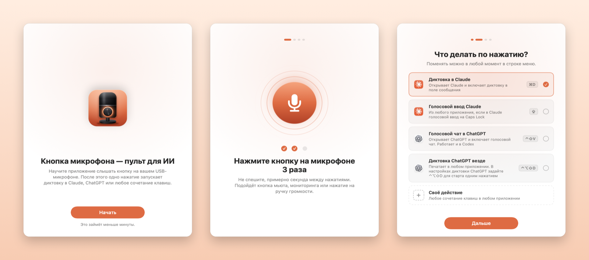

<p align="center">
  
</p>

<h1 align="center">Tapline</h1>

<p align="center"><b>Кнопка на USB-микрофоне — пульт для ИИ.</b><br>
Приложение для строки меню macOS: кнопка мьюта, мониторинга или ручка обычного проводного микрофона запускает диктовку в Claude, голосовой чат в ChatGPT или любое сочетание клавиш.</p>

<p align="center"><a href="README.md">English</a> · <a href="docs/microphones.ru.md">Какие микрофоны подходят</a></p>

У многих USB-микрофонов есть кнопка: мьют, мониторинг в наушниках или нажатие на ручку громкости. Tapline превращает это нажатие в действие на Mac. Нажали — в Claude включилась диктовка. Нажали ещё раз — выключилась. Макроклавиатура и отдельный пульт не нужны.



## Что умеет

**Запоминает вашу кнопку.** При настройке вы трижды нажимаете кнопку. Tapline следит за переключателями и HID-сообщениями микрофона и запоминает сигнал, который менялся вместе с нажатиями. Списка поддерживаемых моделей нет: попробуйте свой микрофон, и настройка скажет, если кнопку не слышно.

**Даёт кнопке работу.** Готовые действия:

| Действие | Что происходит |
|---|---|
| Диктовка в Claude | Открывает Claude и включает диктовку в поле сообщения (⌘D) |
| Голосовой ввод Claude везде | Запускает голосовой ввод Claude из любого приложения. Сначала назначьте его в Claude на Caps Lock |
| Голосовой чат в ChatGPT | Открывает ChatGPT и включает голосовой чат (⌃⇧V). Работает и в Codex |
| Диктовка ChatGPT везде | Печатает сказанное в любом приложении. Сначала задайте в настройках диктовки ChatGPT сочетание ⌃⌥⇧D для старта одним нажатием |
| Мьют в Zoom, Teams, Slack, Discord | На мгновение выводит приложение созвона вперёд, включает или выключает микрофон и возвращает вас туда, где вы были |
| Своё действие | Любое сочетание клавиш — в выбранное приложение или в то, что сейчас на экране |

**Легко вернуть как было.** Выберите в строке меню «Работает как обычно», и Tapline оставит кнопку в покое.

## А прежняя функция кнопки остаётся?

Зависит от микрофона. Если нажатие переключает регистр, в который компьютер может писать, Tapline возвращает его обратно, и кнопка мьюта запускает диктовку, не заглушая вас. Некоторые микрофоны такую запись не принимают: на RØDE NT-USB Mini ручка по-прежнему переключает мониторинг в наушниках. Кнопки, которые сообщают о нажатии через HID, всегда сохраняют прежнюю функцию. Какой случай у вас, подскажет настройка.

## Как это устроено

Многие USB-микрофоны обрабатывают кнопку внутри прошивки. Нажимаете — микрофон тихо переключает что-то у себя внутри, например мониторинг в наушниках, и ничего не сообщает компьютеру. Но этот переключатель можно прочитать по USB, так же как macOS читает громкость микрофона. Tapline проверяет его двадцать раз в секунду, замечает переключение и запускает ваше действие.

Микрофоны, которые сообщают о нажатии HID-событием, тоже подходят. Tapline открывает только служебные и телефонные HID-интерфейсы самого микрофона и пропускает всё, что похоже на клавиатуру, мышь или медиаклавиши, поэтому macOS не просит разрешение «Мониторинг ввода».

Что не заработает: Bluetooth-микрофоны и кнопки, которые действуют целиком внутри микрофона и не меняют ничего, что видно компьютеру. В [списке микрофонов](docs/microphones.ru.md) собрано, что известно о популярных моделях.

## Установка

Нужны macOS 14 или новее и Xcode Command Line Tools (`xcode-select --install`).

```bash
git clone https://github.com/vnptb/tapline.git
cd tapline
./build.sh
```

Скрипт установит Tapline в `/Applications` и откроет его. Чтобы нажимать сочетания клавиш, Tapline нужно разрешение «Универсальный доступ» — macOS спросит один раз.

Сборка подписывается локально, и macOS привязывает разрешение к конкретной сборке. После пересборки удалите Tapline в «Системные настройки» → «Конфиденциальность и безопасность» → «Универсальный доступ» кнопкой «−» и разрешите заново. Чтобы разрешение переживало пересборку, подпишите приложение сертификатом для подписи кода (подойдёт и самоподписанный): `SIGN_IDENTITY="Ваш сертификат" ./build.sh`.

Иконка лежит в `icon/icon.svg`; после правки запустите `icon/make_icon.sh`.

## Микрофоны

| Микрофон | Кнопка | Работает |
|---|---|---|
| RØDE NT-USB Mini | Нажатие на ручку наушников (мониторинг) | ✅ Проверено |
| RØDE PodMic USB, XCM-50, XDM-100 | Нажатие на ручку наушников (мониторинг), та же конструкция, что у NT-USB Mini | 🟢 Должно работать |
| Shure MV7+, Shure MV6, HyperX SoloCast, Elgato Wave:3 | Сенсорный мьют | 🟢 Должно работать |
| HyperX QuadCast, DuoCast, Blue Yeti, Yeti X, Yeti Nano, Razer Seiren, Audio-Technica AT2020USB-X, Sennheiser Profile, AKG Lyra, Elgato Wave:1 и Wave Neo, FIFINE, MAONO, JBL Quantum Stream и другие | Кнопка мьюта, сенсорный мьют или нажимная ручка | 🟡 Может заработать |
| HyperX QuadCast S, QuadCast 2, Logitech G Yeti GX, Shure MV7 | Сенсорный мьют | 🟡 Может заработать, но микрофон останется заглушённым |

В [полном списке](docs/microphones.ru.md) больше 90 моделей: RØDE, Shure, HyperX, Elgato, Blue, Razer, Audio-Technica, FIFINE, MAONO и другие. Попробовали свой микрофон? [Откройте issue](https://github.com/vnptb/tapline/issues/new): модель, какую кнопку нажимали и распознала ли её настройка.

## Приватность

Tapline не записывает и не слушает звук: он не открывает аудиопоток, поэтому macOS даже не спрашивает доступ к микрофону. По USB он читает переключатели микрофона (мьют, мониторинг) и сообщения его кнопок. После нажатия он возвращает переключатель, который сдвинула кнопка, — и больше ничего в микрофон не пишет. Ничего не уходит с вашего Mac.

## Лицензия

MIT
